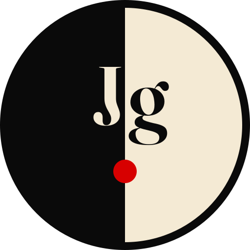
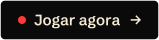

<a id="top"></a>

<div align="center">

<picture>
  <source media="(prefers-color-scheme: dark)" srcset="https://raw.githubusercontent.com/voaneves/js-games/main/assets/logo/logo-dark.svg" />
  <source media="(prefers-color-scheme: light)" srcset="https://raw.githubusercontent.com/voaneves/js-games/main/assets/logo/logo-light.svg" />
  
</picture>

<h1>js-games</h1>

<p>
  <strong>Jogo da velha, pedra-papel-tesoura, cobrinha e campo minado, jogáveis no navegador.</strong><br />
  <sub>JavaScript puro, sem frameworks e sem build, instalável como PWA</sub>
</p>

<p>
  <a href="https://voaneves.github.io/js-games/"><picture><source media="(prefers-color-scheme: dark)" srcset="https://raw.githubusercontent.com/voaneves/js-games/main/assets/buttons/live-dark.svg" /></picture></a>
  <a href="#jogos"><picture><source media="(prefers-color-scheme: dark)" srcset="https://raw.githubusercontent.com/voaneves/js-games/main/assets/buttons/games-dark.svg" /></picture></a>
</p>

<p><sub>Precisa de algo assim? <a href="https://voaneves.com/#contato"><strong>Vamos conversar →</strong></a></sub></p>

<p>
  <a href="https://github.com/voaneves/js-games/blob/main/LICENSE"></a>
  
</p>

<p>
  <a href="https://voaneves.github.io/js-games/">Jogar</a> ·
  <a href="#jogos">Jogos</a> ·
  <a href="#rodar-localmente">Rodar localmente</a> ·
  <a href="#estrutura">Estrutura</a> ·
  <a href="#contato">Contato</a>
</p>

</div>

<picture>
  <source media="(prefers-color-scheme: dark)" srcset="https://raw.githubusercontent.com/voaneves/js-games/main/assets/brand/rule-dark.svg" />
  <source media="(prefers-color-scheme: light)" srcset="https://raw.githubusercontent.com/voaneves/js-games/main/assets/brand/rule-light.svg" />
  
</picture>

## Jogos

Quatro jogos clássicos para jogar direto no navegador, escritos em JavaScript puro, sem frameworks e sem etapa de build.

**Jogue agora:** <https://voaneves.github.io/js-games/>

*English: classic browser games in vanilla JavaScript (Tic-Tac-Toe, Rock-Paper-Scissors, Snake and Minesweeper), as a static PWA.*

| Jogo | Código |
| :--- | :--- |
| Jogo da velha | `assets/js/tic-tac-toe.js` |
| Pedra, papel e tesoura | `assets/js/rock-paper-scissors.js` |
| Jogo da cobrinha (Snake), com botões direcionais na tela | `assets/js/snake.js` |
| Campo minado | `assets/js/mine.js` |

Também há tema claro e escuro (`prefers-color-scheme`), suporte a `prefers-reduced-motion` e instalação como PWA (`manifest.json` e `sw.js`).

## Rodar localmente

Não há dependências. Sirva a pasta com qualquer servidor estático (o service worker exige `http://localhost` ou HTTPS):

```bash
git clone https://github.com/voaneves/js-games.git
cd js-games
python -m http.server 8000
# abra http://localhost:8000
```

## Estrutura

```
index.html          página única com os jogos
manifest.json       manifesto do PWA
sw.js, worker.js    service workers (versões .min.js usadas na página)
assets/
  fonts/            fonte de ícones
  img/              ícones e imagens
  js/               um arquivo por jogo, mais app.js, cursor.js, console.js
  styles/           SCSS e CSS compilado (games.scss)
```

## Tecnologias

HTML, CSS/SCSS, JavaScript puro, Canvas (Snake), PWA.

## Licença

[MIT](https://github.com/voaneves/js-games/blob/main/LICENSE) © Victor Neves

## Contato

<p>
  <a href="https://voaneves.com/#contato"><picture><source media="(prefers-color-scheme: dark)" srcset="https://raw.githubusercontent.com/voaneves/js-games/main/assets/buttons/hire-dark.svg" /></picture></a>
  <a href="https://voaneves.com/"><picture><source media="(prefers-color-scheme: dark)" srcset="https://raw.githubusercontent.com/voaneves/js-games/main/assets/buttons/site-dark.svg" /></picture></a>
</p>

<a href="https://linkedin.com/in/voaneves">LinkedIn</a> · <a href="mailto:victorneves478@gmail.com">E-mail</a>

<p align="center">
  
</p>

<p align="center"><sub>Distribuído sob a <a href="https://github.com/voaneves/js-games/blob/main/LICENSE">licença MIT</a>.</sub></p>

<p align="center"><sub><a href="#top">↑ Voltar ao topo</a></sub></p>
